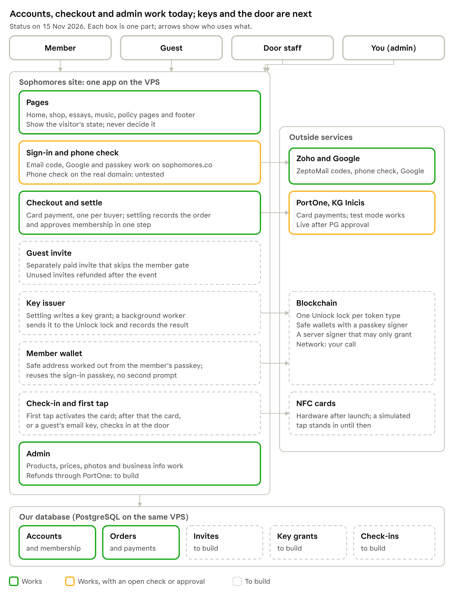
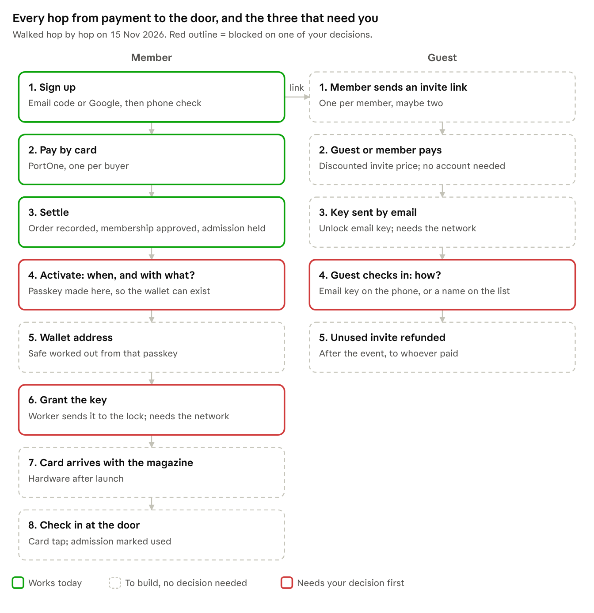

# Auth · Payment · Unlock/NFC — one branch, one plan

Live copy: https://claude.ai/artifact/Bt65UugGE56CBfTSRnXKkf · repo copy exported 2026-11-15 · the live copy and this file are kept in step by the custodian.

## How it all connects

Follow one purchase along the arrows. A member, or a guest with a paid invite, pays by card. The payment settles once, settling grants the key, and the key opens the door. Parts that work today stay as they are; new parts are added around them. Comment on any box to add, change or remove it, and I'll answer with what that affects before changing anything.

### Journeys, hop by hop

I re-walk this every time anything changes. A hop with no code, no decision from you, or no owner gets listed in the change log before I act.

### Gaps found walking the journeys (15 Nov)

The biggest gap is one my own plan text got wrong. It said the key is granted when the order settles. Your decision was that the member's passkey is created at activation, and the wallet address is worked out from that passkey. So there is nowhere to send a key until the member activates, and activation was meant to be the first NFC tap, which only happens after launch. As written, no member would receive a key at launch.

| Gap | Why it matters | Proposed default |
| --- | --- | --- |
| When and how a member activates | The key can't be granted before the wallet exists | Activate on the website right after payment: one passkey prompt, then the key is granted. The NFC card's first tap later links the card to that key |
| The member never makes a passkey | Sign-up allows email or Google only | Activation asks for the passkey; until then the member page says "Activate your membership" |
| Network | Lock, wallet and server signer all depend on it | **Base**, testing on Base Sepolia. Polygon has no Unlock testnet ([Unlock: no Amoy support](https://github.com/unlock-protocol/unlock/issues/13429)). Base has Unlock v14 ([networks](https://github.com/unlock-protocol/unlock/tree/master/packages/networks/src/networks)), Safe passkeys v0.2.1 ([deployments](https://github.com/safe-global/safe-modules-deployments/tree/main/src/assets/safe-passkey-module/v0.2.1)) and native passkey verification, at about $0.002 a transaction |
| Guest check-in method | The door can't be built without it | The door reads our admissions list, so a guest shows their email key or gives their name, and staff mark it used |
| What the door trusts | A live chain read at the door is slow and fails offline | The door checks our database; the chain is the ownership record behind it |
| Server signer and lock | A key on the server that may only grant keys, plus a funded lock | Testnet first, with a throwaway signer funded from a faucet; mainnet after your Bithumb funding |
| Manual refund of a paid key | No rule for whether the key is cancelled | A manual refund cancels the key (the platform holds key-manager rights) |
| New code libraries | No chain libraries are installed | viem plus Safe's passkey kit; installing them needs your OK |

Worth noting: the sign-in passkey already stores its public key in our database, so the wallet can reuse it. No second passkey ceremony is needed.

## Working with Gemini and Claude in step

There is one source of truth: this plan, and its decision ledger in particular. Both assistants read it, and only you change what counts as decided.

1. **Shared copy.** After every change I export this document and both diagrams into the repo at `docs/qa/auth-payment-nfc/`, which Gemini in Antigravity can read. The live doc and the repo copy always match.
2. **Gemini's ideas go to an inbox,** not straight into the plan. Save each session's output as a file in `docs/qa/auth-payment-nfc/inbox/`, one file per topic. Gemini can write it there itself.
3. **I take in each inbox file** the same way as your own changes:
   - I note where it agrees with the ledger, where it conflicts, and what it would affect or break;
   - I add that as a change-log entry and mark the file taken in.
4. **You confirm, and only then does it enter the ledger.** Until then, ideas from either assistant are proposals.

## How changes are made

This plan is never final. It changes whenever you realise something, without anything being rebuilt from scratch.

1. **You say it.** Comment on a box, write here, or tell me in chat.
2. **I write its impact first,** in the log below: which parts it touches, what would break, and what stays as it is.
3. **You confirm or adjust.**
4. **I make the change,** check that everything else still works, and update the map.

Parts that work stay. New parts are added around them, and nothing is replaced wholesale unless you decide to replace it.

Change log, newest first:

| Date | Change | Touches | Breaks or kept | Status |
| --- | --- | --- | --- | --- |
| 2026-11-14 | Live card payment, one unit per purchase, membership on payment, business-info admin page with footer and policy pages | Card checkout, settle, membership, the site footer, terms, privacy and refund pages | Policy pages keep their current text until you fill in the admin page; the footer appears only once the required business facts are filled. The old ticket code still exists | Done, on `main` |
| 2026-11-14 | Stale branches deleted; finished branches now close right away | Repo only | Nothing; all archived | Done |
| 2026-11-14 | Sign-in and checkout accept sophomores.co | Sign-in, phone check, card checkout | Local development unchanged. At deploy, the proxy must pass the real address | Done |
| 2026-11-14 | Mechanisms moved to one branch | Every branch's scope | Nothing broken; no code moved | Done |

## Your decisions so far

This is the ledger everything else is checked against. A decision you made explicitly wins over anything an agent wrote; if two of yours conflict, the later one wins. Anything not on this list is a proposal, and when it conflicts with something else, I bring it to you.

| Date | Decision | Where you said it |
| --- | --- | --- |
| 2026-11-14 | Mechanisms live on one branch; the plan is iterated, and I check impact before every change | Chat |
| 2026-11-14 | Finished branches are merged and deleted right away; stale ones are deleted | Chat |
| 2026-11-14 | Quiet live launch on sophomores.co by Sunday, replacing Hideaway and LOSTINSEOUL on the VPS; the domain already points there | Chat |
| 2026-11-14 | You manage description, pictures and price in the admin; design and layout stay fixed | Chat |
| 2026-11-14 | Standard checkout pattern, as other companies do it, instead of the I3–I6 machinery | Chat |
| 2026-11-14 | One unit per buyer | Scope review comment |
| 2026-11-14 | Payment grants membership | Chat |
| 2026-11-14 | Customised product, so no returns; this is not tied to activation | Scope review comment |
| 2026-11-14 | The guest invite is a separate paid product that skips the membership gate. Unused invites are refunded, and offline corrections are made by hand | Chat |
| 2026-11-14 | Guests are email-only, through Unlock | Scope review comment |
| 2026-11-14 | Member wallet: Safe with a passkey owner, not Kernel | Unlock × NFC plan comment |
| 2026-11-14 | NFC: first tap activates, then the card is the check-in credential | Unlock × NFC plan comment |
| 2026-11-14 | Perks stay as package detail | Scope review comment |
| 2026-11-14 | Bank transfer is separate from the PG route | Chat |
| 2026-11-14 | Delete dead weight once its replacement works | Scope review comment |
| 2026-11-14 | Live-readiness work: just implement, with no Santa review | Scope review comment |
| 2026-11-14 | PG through PortOne 바로오픈 (KG Inicis); you file the application once production is confirmed, before Monday | Scope review comment |
| 2026-11-14 | Payload code lives in `src/payload/`; the three Payload root files stay at `src/` | Chat |

## The rule

One branch, `codex/auth-payment-nfc`, owns *how* sign-in, phone verification, payment, Unlock keys, NFC and guest invites work. Every other branch builds pages and never touches that. This document is that branch's single plan and replaces the earlier scattered ones, including the Commerce scope review.

- **Created** 2026-11-14 from `main` (`0770cf3`) and pushed. The rule is in AGENTS.md and the worker shared rules.
- **Owned paths:**
  - `src/lib/{member-auth, phone-verification, auth, commerce, tickets, invitation}`;
  - the commerce and order collections, and the sign-in and membership fields on users;
  - the auth, member and phone-verification API routes;
  - the purchase steps (`tickets/payment`, `shop/payment`, `shop/orders`, `shop/invitations`, `account/continue`);
  - `src/components/{Authentication, auth, commerce, tickets}`;
  - their tests.
- **Interface work is part of the branch.** Interface pieces that only exist because of a mechanism, such as the sign-in sheet, the checkout step and the key status, are edited here, not on page branches.
- **Flow:**
  - `main` is merged into this branch regularly.
  - Finished, reviewed slices merge back to `main`; I do that.
  - Any worker on this mechanism work starts from this branch.
  - Nothing lands on `main` directly.
- **Already in flight:**
  - The Sunday build's payment mode, one unit per purchase and membership-on-payment changes come here.
  - The production sign-in work comes here too.
  - The Sunday build's business-info global, policy pages and footer go straight to `main` as page work.

## What pages may depend on

Page branches only see the states below. However authentication or payment works underneath, a page needs only to know which state the visitor is in.

| Track | States a page can show | Where a page reads it |
| --- | --- | --- |
| Account | Signed out · signed in; membership: applicant, invited, approved, waitlist, suspended, staff | the existing session helper and `users.membershipStatus` |
| Purchase | Not purchased · pending · paid · failed | the order for this visitor |
| Key | No key · issued · activated (NFC) · checked in | the visitor's ticket or key record |
| Invite | No invite · invite to pay · paid invite · used | the invite record |

If a page needs a state that isn't listed, add it to the request list below instead of building it on the page branch.

**Requests from page work:** none yet.

## Branches, checked against git

Cleaned on 2026-11-14. There were 32 local branches; 24 were stale and are deleted. Their code was already on `main` or on this branch, or one of your decisions had superseded it. Eight remain:

| Branch | State | What happens |
| --- | --- | --- |
| `main` | Live | Page work lands here |
| `codex/auth-payment-nfc` | Live | This plan's branch |
| `codex/sunday-launch-20261115` | Active worker | Merged when it reports, then deleted |
| `feature/product-production` (worktree `hamlet`) | Active: a session committed sales-page and commerce-experience drafts in the last 20 minutes | Left alone. It carries history from before the rewrite, so it must be cherry-picked when it lands, never merged |
| `codex/main-checkout-preserved-…` | Your original checkout in `Projects/sphmrs`, with the env file and 24 uncommitted changes | Kept |
| `experiments/flame-depth-20261025` | Kept on purpose ("preserve rejected flame depth experiment for later") | Kept |
| `studies` (22 Oct) | Three unmerged commits: footer field, flame editor, teaser removal. `main` has since taken the approved flame footer | **Your call** |
| `xnxchoi/gar` | One commit adding `.mcp.json` for the uiarc.dev design MCP; also on GitHub | **Your call:** commit it to `main`, or keep it local |

Everything deleted is recoverable. The archive outside the repo holds a bundle of all 24 branch tips plus each worktree's uncommitted files. To restore a branch, fetch it back from that bundle.

From now on, a finished worker's branch is merged and deleted in the same step, and I report it rather than ask (AGENTS.md, Branch lifecycle).

## Document map

Only four documents still steer the work. They are folded into this one; the rest are history or evidence. On this branch, older documents are read as background, never as instructions.

| Document | Status | Why |
| --- | --- | --- |
| Commerce scope review (`commerce-scope-review-20261114/summary.md`) | Folded in here | Your 2026-11-14 decisions on checkout, one unit and membership on payment |
| Unlock × NFC reconciliation (`unlock-nfc-plan-20261114/reconciliation.md`) | Folded in here, from line 34 | Safe with a passkey owner; first tap activates, then the card is the check-in credential |
| Sunday and production sign-in specs | Current | The two Sunday slices |
| Unlock integrator report (`unlock-integrator-20261114/report.md`) | Reference | What Unlock actually returns |
| Frontend plan (`unlock-nfc-plan-20261114/plan-frontend-antigravity.md`) | Reference | The substance stands; its copy is placeholder |
| Backend plan (`plan-backend-codex.md`) | Partly superseded | Slices 2–5 are the old I3–I6 machinery |
| Commerce launch plan (`docs/reference/commerce-launch-plan.md`) | **Superseded**, though it still calls itself governing | Three per account, gifts, no guest checkout, and the product called a coin |
| Ticket account planning, T002 model, I3 spec | Superseded | Several units per buyer, gift claims |
| Uncharged-payment recovery note | Superseded | Reuses the old payment ID instead of a new one per attempt |
| Policy drafts (`commerce-policy-drafts.md`) | Superseded | Full refund until 3 Dec, and a Hideaway support address |
| Unlock blueprint, your original plan, integration spec | Background | Research; options already decided |
| Phone verification research | Background | Carrier facts; still valid |
| T004 I0–I2, T002-P2a, T005, Unlock auth/shape/launch, October auth notes | Evidence only | What was built and why |

Two plan files exist only on stale branches (`unlock-auth` and `unlock-shape`). Their decisions that still matter are listed under inconsistencies below.

## Inconsistencies

Nine conflicts, each resolved below. Two of them affect Sunday: the phone check, and the legacy ticket checkout the Sunday build edits.

| Topic | What the documents say | Resolved as |
| --- | --- | --- |
| Units per buyer | Commerce launch plan, To-Do T002, T002 model and I3 spec say three, with gifts; scope review, reconciliation and Sunday spec say one | **One.** The old documents are superseded |
| Refunds | Four rules: not refundable before activation (To-Do:320); returns only *while* the key is not activated, the opposite (reconciliation:38); full refund until 3 Dec (policy drafts); physical-goods rules (launch plan) | **Your call:** customised product, no refunds except by hand. Confirm below |
| Guests | Launch plan: guests must register, and admission is tied to an account. Scope review: guests use the email key or check out without an account | **Scope review.** Guest check-in at the door is still undefined |
| Membership gate | Launch plan: verify before taking part. Scope review: the guest invite skips the gate | **Scope review** |
| Wallet | Your original plan: Safe or Kernel. To-Do (13 Nov): address derived from email. Reconciliation (14 Nov): Safe with a passkey owner | **Safe with a passkey owner** |
| Payment ID on resume | The uncharged-recovery note and the I3 spec reuse the same attempt and forbid expiring it. The scope review wants one ID per attempt, with abandoned attempts expiring | **One ID per attempt**, reused only to resume that same attempt |
| Which checkout | The Sunday spec edits `src/lib/tickets/portone/config.ts`, but the scope review calls the old ticket checkout dead code | **Check at integration:** Checked: the shop uses the new checkout, but it borrows one payment-ID helper from the old ticket code, and \`/tickets/payment\` is still a live page. So the old code is not dead yet |
| NFC order | The member already holds a key before the first tap (your plan) · the key is minted after activation (reconciliation:28) · activation happens at arrival (To-Do) · first tap activates, then the card checks in (reconciliation:37) | **First tap activates, then the card checks in.** Cards come after launch anyway |
| Network | Stale `unlock-shape` decision says Base; main assumes Polygon | **Your call:** listed below |

Other gaps still to settle:

- **Phone check on the web.** Research says a web page can't force an MMS (`phone-verification.md:105-108`). Before Sunday I test the real phone check once on sophomores.co. If it fails, registration falls back to email plus Google for the quiet launch.
- **Passkeys made on localhost** don't carry over to the real domain. No real users have them, so nothing is lost.
- **Support email.** The policy drafts use a Hideaway address; the To-Do uses `concierge@sophomores.co`. You set this in the new business-info page in the admin.
- **Stale-branch decisions still worth keeping:**
  - one Unlock lock per token type, because one key per address blocks holding two types;
  - our own lifetime cap on granted keys, because granting skips the supply cap;
  - a policy for stuck server transactions;
  - email-derived addresses can be guessed from an email list, which matters for the guest email key.
- **Same word, different things.** "Kernel" means both the unused token kernel and a wallet type. "Activation" means three different steps. "Product" means a coin, a magazine or a token. From here on: *wallet* for the Safe, *first tap* for NFC activation, *check-in* for the door*. The reconciliation calls the product a magazine; confirm that name*.

## Bloat and redundancy

Most of the code bloat is I2. It adds about 2,600 hand-written lines (code, tests and evidence), plus a generated 11,800-line migration snapshot, all for an edge case that the standard checkout covers far more simply. The documents restate one admission policy in four places.

**Code to delete, once its replacement works** (you approved deleting dead weight):

- **I2 reconciliation machinery.** 97 files in its squash commit: `src/lib/commerce/portone/{accounting, admission, ledger-transaction, policy}.ts`, the reconciliations collection and its migration, and the tests. Delete it after step 4.
- **Legacy ticket checkout** (`src/lib/tickets/portone`). The scope review called it dead code, but it isn't: \`/tickets/payment\` is still a live page, and the shop borrows its payment-ID helper. Removing it means moving that helper first and retiring the page. That's your call: keep it, or remove it after launch.
- **Unused token kernel** (`src/lib/commerce/token-entitlements.ts`, 283 lines). Nothing calls it. Delete it, unless step 8 reuses it for key status.
- **The I3 branch.** Not merged; it can be dropped.

**Documents restating the same thing:**

- The admission and allocation policy appears in the commerce launch plan, the ticket account planning, the T002 model and the To-Do. All four are now superseded by this document.
- The payment financial brief is in three places (To-Do, backlog plan, T004-A design).
- The `boundary.md` files on the `unlock-auth` and `unlock-shape` branches are identical.
- Status lines in the To-Do contradict each other: one says I1–I6 haven't started, another that I2 is integrated. I'll replace the To-Do's mechanism sections with a pointer to this document.

**Branches:** 13 local branches are superseded or stale (see the inventory). Deleting them waits for your OK.

## Work order for this branch

Sunday needs only two slices here: sign-in on sophomores.co, and live card payment that grants membership. Everything else follows after launch, one slice at a time.

**By Sunday, 2026-11-15**

1. **Sign-in on the real domain.** Registration and login accept `https://sophomores.co`, with secure cookies and a hosted database. Local development is unchanged. **Done:** merged into this branch on 2026-11-14 (`86b247d`). Shop checkout now accepts the real domain too. At deploy, the proxy must pass `https://sophomores.co` through as the request address.
2. **Live card payment.**
   - Test or live mode comes from config.
   - One unit per purchase.
   - Membership is approved inside the same transaction as the order.
   - **Done:** merged on 2026-11-14. Still to check on the real site: the one-unit add and remove control, which needs a published product and a signed-in member.
3. **Merge both to `main`** after a light review, so the deploy carries them. Done: main is at dfb2e4c. Typecheck is clean, and the full suite shows only the 2 known styling failures.

**After launch**

4. **Standard checkout:**
   - one payment ID per attempt, reused when the buyer resumes;
   - the server re-reads the payment and checks the exact amount;
   - one order per payment;
   - a settle step that is safe to run twice;
   - the webhook only triggers that settle;
   - a periodic re-check job.
5. **Delete the dead weight** once step 4 works: the I2 reconciliation machinery and anything else listed under bloat below.
6. **Refunds.** Done manually from the admin through PortOne's cancel.
7. **Guest invite.** A separately paid invite that skips the membership gate. Unused invites are refunded, and offline corrections are made by hand.
8. **Unlock keys:**
   - members get a Safe account with a passkey owner;
   - guests get their key by email;
   - the key is granted when the order settles.
9. **NFC.** Activation first, then check-in at the door.
10. **Sandbox run.** Every path once, within the 30 test payments.

You file the PG application once production is confirmed, before Monday.

## Test cleanup: impact before anything is deleted

The repo has 411 test files, about 4 MB. About 30 files can go now (groups A, E and the orphan browser specs in B), and only group E loses anything: guards for refactors that are already finished. 8 more tests never run and should be wired in. 15 go later, with the I2 machinery. Up to 99 test the wording of the code rather than what it does; those are rewritten when their code is next touched, not deleted in bulk.

| Group | Files | What they guard | Impact if removed | Proposal |
| --- | --- | --- | --- | --- |
| A. Dead | 2 orphan fixtures with no importer; `rework-hygiene.test.ts`, which only checks the review folder; 5 Python tests for the 25 Oct warp preview, which fail in a clean checkout; one test-discovery file duplicated three times over; a broken test reference in `STAGING.md` | Nothing current | None. The suite and typecheck are unaffected | **Remove now** |
| B. Never run | 3 database tests (including the membership-grant proof), 3 deployment `.mjs` tests (backup, restore, TLS hook) and 2 Python tooling tests: nothing invokes them. 11 browser specs have no runner | Real behaviour, but unenforced | Removing loses nothing today. Wiring them in adds checks | **Wire in** the database, backup/restore/TLS and tooling tests as an opt-in gate. **Delete** the 11 orphan browser specs; the 3 documented ones stay |
| C. I2 machinery | 12 tests import it directly, plus `fix4`, `rework`, the I2 database fixtures and `generation-isolation.cjs` | The reconciliation edge case | The review, retirement and webhook tests share an I2 fixture; split it first or they break | **With step 5**, after the simple settle works, not now |
| D. Unused token kernel | `token-entitlements.test.ts` (38 KB) and its fixtures | Code nothing imports | None for the site | **With your call** on the token kernel box in the map |
| E. Guards for past refactors | `src-relocation`, `source-ownership-*`, `legacy-loops`, `calendar-state-colors`, and the pre-refactor shader snapshots that pin "every original byte" | That a finished move or refactor wasn't undone | You lose nothing current, but a reverted refactor would no longer be caught. The policy rules (Tailwind-only, Payload placement, full motion) stay | **Remove**; keep only the rules still in AGENTS.md |
| F. Brittle text checks | Tests asserting exact shader numbers, column strings, class names or function names | Implementation details | Each one fails on any refactor, even a correct one | **Rewrite as behaviour tests** when that code is next touched; no mass deletion |
| G. Process names, real behaviour | `authentication-phase-studies`, `real-payload-acceptance` | Real login and payment behaviour | None | **Rename** to describe the behaviour |

The 2 known styling failures stay deferred, as you set earlier.

**Done 2026-11-14** (`main` at `b4807cd`). The suite is down from 2,980 to 2,873 tests, still with only the 2 known styling failures, and the typecheck is clean.

- **A:** done.
- **B:** done.
  - The 12 browser specs nothing could run are gone.
  - The deployment-script and Python tests now run with `--tooling`. One of them had drifted: it expected a 6 GiB dev memory cap where the script uses 5. It now checks for at most 6.
  - The membership database proof now has a launcher that creates and removes its own throwaway database. It passes 5/5.
- **C:** the endpoint ledger helper has its own file, so the webhook test no longer touches I2. The review and retirement tests still need I2, because the code they test calls it; that goes away with step 4.
- **D:** the unused token kernel and its tests are deleted. They can be recovered from git.
- **E:** kept. On inspection most of these check current behaviour, including a security boundary on notification actions, the Tailwind and migration setup, and the shipped flame shader values.
- **G:** renamed to `email-code-and-signup-flow` and `inventory-concurrency-and-returns.db`.

One finding for step 4: the old I0 payment-durability database proof had been failing since I2 landed, because confirmation now needs the reconciliation step first. Nothing ran it, so nobody noticed. It is retired with I2, and the standard settle gets its own database proof.

## Your decisions still open

None of these block Sunday. They come from the scope review and this consolidation.

- [ ] **Stale branches.** May I delete the local branches marked superseded or stale above, including `feature/product-production`?
- [ ] **Guest check-in.** How does a guest without a Safe account check in at the door: an email key on their phone, or a name on the list?
- [ ] **Card only at launch.** Bank transfer stays out of the PG route; confirm that it is out entirely for now.
- [ ] **Cancelling before shipping.** Since this is a customised product, is there any cancellation window before it ships?
- [ ] **If the event is cancelled.** Full refund through PortOne, or handled by hand?
- [ ] **Guest becoming a member.** After an invited guest attends, do they get an offer to create an account? The scope review proposed this, but it hasn't been approved.

- [ ] **Refund rule.** Confirm the single rule: customised product, so no refunds after purchase except by hand. This retires the four conflicting rules listed above.
- [ ] **Network for Unlock keys.** Polygon (what main assumes) or Base (a stale decision)?
