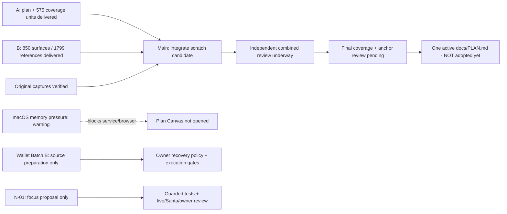

# Sophomores Custodian Board

**HISTORICAL** evidence recorded 2026-11-17, not an active work queue or release
approval. Current status, routing and decisions live only in
[`docs/qa/auth-payment-nfc/consolidation.md`](../auth-payment-nfc/consolidation.md).
All snapshots, assignment states and resource warnings below are dated history;
they do not grant current execution authority.

Provenance correction, 17 Nov: the canonical plan's failed-attempt accounting
cross-links abandoned notification Dispatches `ctx_6a599957c0db` and
`ctx_b2f5f25fb628`, and separate failed W-01 `ctx_fe361decdf9c` with unavailable
transcript/null result and unverifiable process state. The earlier terminal-release
claim below remains historical evidence, not verified current liveness or an
accepted wallet manifest. Conversation recovery does not clear failed attempts.

## Progress Snapshot - 17 Nov, 03:58 UTC

**HISTORICAL snapshot.** This diagram projects the canonical plan at 03:58 UTC;
it is not an approval control or a second plan. Its memory-pressure warning
subsequently cleared, as recorded in the canonical plan. The diagram, table and
evidence below remain dated, not current status or workload admission.

| Lane | Verified checkpoint | Next actor / gate |
| --- | --- | --- |
| Plan consolidation | Both scratch handoffs arrived; main-only reconciliation underway | Main freezes combined candidate; independent review and current/historical anchors before adoption |
| Docs / agent surfaces | Inventory returned; 27 README script rows statically match source | Main preserves installed/local agent assets; zero SAFE deletions |
| Visualization | Static diagram prepared; no canvas service or browser started | Fresh resource admission required: 48 GiB host, macOS pressure level 2, zero guard-admissible headroom |
| Wallet | Two-path preparation has source-only PASS, not executed RED/GREEN | Owner recovery-policy choice; native transaction/total-work and scoped execution gates |
| Notifications | N-01 source proposal only, keyboard-focus finding still open | Hamlet after resource admission; actual focus/live/Santa and owner-seen-live pending |
| Release | Default suite, functional/provider, recovery and exact-artifact gates remain | Existing plan governs; no dependency, provider, DB, push or deployment authorization |

Canonical plan synced after the owner flagged drift: Waiting for you, current
coordination/review/preparation/resource states and live-session routing now
match this checkpoint. Work-order/flow content and the entire History suffix
are byte-identical to the pre-sync snapshot. Main requested independent
source-only docs review through Undine (`msg_59a41bda5c87`); review is pending,
with no commit/push or execution grant.

## Current Execution Checkpoint

Latest reviewed checkpoint supersedes older samples below: canonical plan v2
records c0c17fbe resource envelope **18.810 GiB before / 20.310 GiB with proposed
job+tolerance**, conservative mixed accounting, not proven pure agent allocation.
Captured chat PIDs were readable; churn/guard identity/census completeness remain
unproved. Admission stays closed. Two-path delta `f88b7072` has source-only
PREPARATION PASS, not runtime/TDD/GREEN/native/cap acceptance. Both DOC-01 lanes
actually started (Undine `msg_43444b09c0a7`); their drafts must include this
post-snapshot correction. Main correction review requested `msg_e317ea9c2b47`.

The existing reviewer returned scoped v2 resource/PREP-freshness PASS in
`.inbox/plans/task_332168093e4e-docs-recheck.md` (Undine `msg_e7d2b9a6246d`).
Work-order/History preservation was rechecked; DOC-01 consolidation itself was
outside that review. This is not whole-v2/migration approval or workload admission.

DOC-01 actual handles: lane A `ctx_318d3443ea53` / `task_99caf3ad6873`, start
ACK `msg_ac4bcfce29ca`; lane B uses existing N-01 `ctx_b2f5f25fb628` /
`task_3a13fd1eac9e`, inventory ACK `msg_3d4dc9e07eff`. Lane B inventory is a
status subdeliverable, not completion of the still-unresolved focus fix.

DOC-01 preservation complete: `docs/archive/planning-20261117/manifest.json`
records verified byte-exact To-Do capture `3f7001f3` and current mechanism capture
`d63178d0`, with original link bases documented. These are frozen historical
inputs, not active parallel plans. Migration/coverage/reference review is pending;
the original plans still govern until main applies the reviewed consolidation.

DOC-01 lane B handback returned under Hamlet
`.tmp/docs-consolidation-20261117/HANDOFF.md` (Undine `msg_395672737f99`),
inventorying 850 surfaces and 1,799 static references; zero SAFE deletions.
Sixteen scratch drafts are not adoption/coverage proof. Main verified all 27
README script rows match current `package.json` keys/values/hash without execution.
Integration feedback `msg_e90a19f5a861` requires canonical archive-path alignment,
renderable historical heading targets and lane A's complete all-scopes coverage
before replacement. N-01 remains unresolved, not completed by this inventory.

Owner added DOC-01: merge the To-Do List and mechanism consolidation into one
current all-scopes plan/progress source, then consolidate docs and agent-serving
entrypoints. Main delegated inventory/reconciliation through Undine
(`msg_90ad07609efa`) using the requested refactor-clean/update-docs skills.
Retained auth owns plan-coverage analysis; recovered Hamlet owns docs/.agents/
.codex reference/retirement inventory, each writing only its own scratch handback.
Main alone applies reviewed edits. Candidate structure is `docs/PLAN.md` plus a
focused docs index, with compatibility pointers and byte-preserved originals.
No deletion, heavy run, runtime/config change, commit or push is authorized by
the inventory assignment; full coverage/reference and owner-decision preservation
review precede retirement. Existing Batch B and N-01 gates remain independent.

The owner confirms there is no other instance on this checkout. Undine explicitly
confirmed provenance for the five main commits in `msg_e9270efd4227` and will not
write main while this custodian is live. Main checkpoint `813bd8d4` is the working
baseline; the earlier unexpected-writer stop is cleared.
The canonical plan's current coordination entries supersede older branch-count
and completed-review snapshots in this board. In particular, main contains the
narrow Hamlet token integration `f13f8cd`, auth has Batch A `d31f2349`, and the
wallet foundation has behavioral RED only, not an accepted production port.

Current reporting chain: main custodian `run:run_bbf9450ca334` owns overall/main
coordination and canonical ledger; Undine `run:run_f7d117af78fa` coordinates the
wallet workstream; the existing auth session owns mechanism writes; Hamlet owns
page/UI writes. Auth acknowledged this in `msg_c7b953d0ac8b` and is waiting for
Undine to reattach it. No duplicate job or production work has started.

The direct Batch B request `msg_6788991f8c78` is now routed through Undine as one
assignment, not two (`msg_2d146bda18cf`, auth acknowledgment `msg_3f366b808f4a`).
Requested deliverable: a **read-only bounded-work proposal** with revised 19-path
allowlist, actual Payload contract, faithful regressions, total transaction-work
bound, continuation semantics and migration/proof gates. No implementation, job,
provider action, commit or merge was authorized.

Independent Reviewer reconnection is confirmed: Undine relayed the acknowledgment
through `ctx_03028ce9623c` / `task_3573fcec2f62`; reviewer `worker_done`
`msg_83461f1e5428` confirms actual receipt, relayed to main as
`msg_5b58d670d4b5`. Main acknowledged durable arrival in `msg_ce8d1e421a55`.
Final review `msg_e09867e620da` remains bounded RED/docs-only checkpoint PASS,
not GREEN, implementation permission or production acceptance. The refused
direct cross-run send and earlier failed delivery remain historical failures;
neither was silently treated as delivered.

## Active

| ID | Work item | Owner / surface | State | Acceptance / merge gate | Evidence and next action |
| --- | --- | --- | --- | --- | --- |
| C-01 | Production-readiness audit | Codex custodian / `main` | Review | Keep no-release until checkout, exact-artifact, and recovery gates are met. | Current HEAD `9ae2d35b`; source and deployment reviews confirm buyer-eligibility, publication, recovery, provider-acceptance, and rollback gaps. No `.github/workflows` or status checks are present for this SHA. |
| C-02 | Correct resource-guard setup note | Codex custodian / `README.md` | Review | Reviewer confirms wording; `git diff --check` passes; do not commit without the normal main-custodian review gate. | Reviewer approved; local diff is 4 insertions/2 deletions. |
| C-03 | Triage the default test suite | Codex custodian / current checkout | Review | Independent review confirms the test-only exclusion is limited to nested checkouts; focused boundary test passes. Keep the remaining owner-deferred styling failures visible. | Added an assertion and exclusion for ignored `.claude/worktrees`; focused guarded test passed 3/3 (1.28s, 0.25 GiB peak). Reviewer approved. |
| C-04 | Resolve deferred UI-style assertions | Owner / reading grid and legacy spinner surfaces | Blocked | Owner decides whether to change the visual treatment before any UI edit. | Full suite's remaining failures: article grid emits `text-[10px]`; `HA_Spinner` uses `animate-spinner`. No visual changes made. |
| W-01 | Wallet integration manifest | Historical Orca Codex assignment | Archived | Superseded by the canonical plan's later manifest, reviews and Batch A/RED evidence; do not relaunch duplicate work. | Run `run_2b9ca801758e`, Task `task_f00a5b096a31`, Dispatch `ctx_fe361decdf9c` failed at hook review; its retained terminal was released successfully. Spec retained as historical scope. |
| W-02 | ADR-0014 guest-invite rework contract | Unassigned Orca Codex worker | Backlog | Preserve wallet-first work order; verify the spec against the latest owner ledger before any dispatch. | Spec: `guest-invite-assignment.md`. Not started; no parallel implementation or replacement milestone. |
| W-03 | Batch B bounded-work proposal | Undine coordinator / auth mechanism owner | Reviewed; two-path test-only preparation authorized | Retained auth owner may prepare only the fake and test file; no execution or production port. | Independent `task_032fe3e28efc-review.md` SHA256 `fee66b40b58b23e1736fff69d32c8695fbff3ceb766c38a2a62b22e8ec33cea3`, relayed `msg_a1e10e0b3505`: provenance/reference PASS, not correctness/native acceptance. P2-01: current RED is characterization, not pagination/budget proof. P2-02: before/after transaction-ID checks do not fence autocommit fallback. Main grant `msg_5e86897b30c6` limits preparation edits to `tests/commerce/domain/storage-fake.ts` and `tests/commerce/keys/member-wallet.test.ts`, preserves original four cases/evidence, requires model-conformance tests and blocked coverage matrix. No execution, source/schema/dependency/provider/DB/browser/commit/merge. |
| V-01 | Exact-main default-suite validation | `main_suite_validation` local worker / no source writes | Blocked | Establish complete conservative agent/browser/MCP footprint accounting and exclude other active guard jobs before any test launch. | Worker returned without launching: RAM 48 GiB, memory-pressure output alone insufficient; no process/log/metrics/test result. Shared heavy reservation released to Undine as `msg_ef7aa29f86d5`; no running validator workload. |
| N-01 | Recover assigned notification-trigger focus correction | Undine recovery coordinator / one Hamlet writer | Custody recovered; admission held | Obtain reviewed conservative resource bounds and focused failing-first/minimal-focus proposal before requesting a workload slot. TDD, live focus, Santa and owner-review gates remain. | `msg_31d270ce8456` relays actual bound-session ACK `msg_ecdfb4a4fc4c` for same Task `task_3a13fd1eac9e`, Dispatch `ctx_b2f5f25fb628`, terminal `term_8f506258-cade-4757-a204-0be8bae649ac`. Narrow N-01 overrides historical broad TASK; HEAD, patch and all five manifest hashes reverified unchanged. Refused retry retained; supported existing-terminal flow made no new Task/checkout/process. Only passive inventory/resource attribution and focused test-plan preparation are allowed. |

## Agent Lanes

| Lane | Agent / owner | State | Output |
| --- | --- | --- | --- |
| Auth / payment source review | `auth_release_review` | Complete | Source-level blockers and file references; no database/provider checks. |
| Deployment / recovery review | `deploy_release_review` | Complete | Local-only deployment profile, absent production rollback, and recovery gates. |
| Handoff branch review | `handoff_evidence` | Complete | Owner-gated items and local branch divergence; no other worktrees opened. |
| Test-boundary review | `readme_review` | Complete | `.claude/worktrees` exclusion is limited and does not weaken the tracked-source boundary. |

Validation follow-up did not execute diagnostics: twice the native worker received
opaque encrypted instruction text, including a short file-path handoff, and could
not recover plaintext. No tests or additional jobs ran. That failed handoff route
is stopped rather than retried indefinitely; its failure is not test evidence or
proof that the machine lacks resources.

N-01 passive resource packet `.tmp/n01-recovery-bootstrap-01a1e72c.json`
reports 48 GiB physical RAM and a mixed-ownership candidate set with 16.34 GiB
readable footprint, 25.55 GiB RSS and 14 unreadable candidates. These are not
admitted agent totals or proof of agent overuse; footprint/RSS are not additive.
Undine is refining attribution and conservative bounds with the existing worker.
No cleanup, source edit, test, preview or browser slot is authorized yet.

Passive ownership refinement: open-file paths and first-line `session_meta`
identify PID 32579's open sessions as unrelated `consulting-researcher` work.
Its physical impact still counts for host headroom; no stop permission exists.
PID 28522 is mixed: one `~/.codex/worktrees/43a2/sphmrs` session and one
`consulting-researcher` session. Retain the mixed tree conservatively until
descendant attribution is established. Main relayed evidence to Undine for
updated per-root bounds; the workload gate has not opened.

Cleanup investigation did not establish retirement authority. Undine's
`msg_fe1dd2e97753` confirms current blocker-audit terminal
`term_8c2c8b10-c600-4a18-bca7-60ad3582593d` (PID 33837) is a resumed,
user-interacted session. Historical Dispatch `ctx_09df8ede050f` points to a
missing predecessor; worker-read refuses `worker_identity_changed`.
Preserve this terminal and its clients. No release/close/kill/trust change or
resource savings occurred; exact current custody or owner instruction would
be needed before retiring it.

Historical N-01 refresh `msg_adccd1060989` kept admission closed: after excluding
the proven consulting tree, readable footprint is about 14.21 GiB, with
unreadable MCP/browser clients still unbounded. This cannot admit a guarded
test under the 15 GiB aggregate ceiling, and conservative 10 GiB physical
headroom is not proven. Blocker-audit PID 33837 contributes only about 0.29 GiB;
retiring it alone would not resolve the gate even if authorized. No job launched
or resource limit changed. Read-only proposal/reviewer handbacks can continue.

Undine's N-01 source review `msg_f65d2e4dd028` clears the prospective narrow
proposal: add inline `focus-visible:inset-ring-2` and
`focus-visible:inset-ring-current` to the notification trigger only. Existing
siblings use Tailwind v4 inset-ring utilities and source review found no
notification state/semantics conflict. No edit, compile or test has run.
Keyboard modality, actual paint/contrast, Escape/focus return, Santa and
owner-seen-live remain gates; static proposal review does not satisfy them.

Batch B policy checkpoint: main has asked the owner whether historical backlog
recovery should be durable automatic catch-up or staff-triggered manual recovery.
Current-payment attachment stays immediate in either design. This is a design
decision only, not schema/job/provider/deployment permission; no answer yet.
Until baseline/contracts and that policy are reviewed, production traversal,
budgets, native transaction fencing/rollback, cursor atomicity and wakeup/producer
races remain blocked. Two-path fake/test preparation may proceed independently;
unexecuted code and fake conformance must not be presented as RED/GREEN or native
correctness proof.

Two-path preparation was dispatched to the same retained auth owner as
`ctx_ba3e9c4837a2` / `task_df96ca8af3b6`, reported by `msg_d15113de5de0`.
No new worker process or checkout; actual start ACK `msg_99c510edbd2f` is
confirmed through `msg_0944b763f9ab`. Original four cases remain byte-preserved;
the worker will append conformance cases first and freeze that sequence before
minimal fake adjustment. No execution/resource lane was used. Independent
source-only review will reuse the existing reviewer after the frozen packet
returns. Dispatch receipt is not proof of work, execution or acceptance.

## Owner-Gated Work

| ID | Work item | Owner / surface | State | Unblock condition | Guardrail |
| --- | --- | --- | --- | --- | --- |
| G-01 | Warp intro and chapter navigation | Custodian scope / `codex/nav-restore` worktree | Blocked | Owner reacts to intro; coordinate with the live worktree owner; verify phone and wide-desktop render. | Branch has 5 unique commits and 9 main-only commits; no blind merge, timing edits, or chapter-nav/menu overlap changes. |
| G-02 | Auth, payment, token and NFC mechanisms | Main custodian oversees / Undine coordinates wallet / auth session writes mechanisms | Ready | Route wallet assignments through Undine to the existing auth owner; isolated workers start from the auth branch only when scoped. | Reporting chain explicitly acknowledged by auth. Current auth is `d31f2349`; the old 112/20 divergence snapshot is historical. No bulk merge or entry into a live worker checkout. |
| G-03 | Wallet activation and `/welcome` | Auth custodian and wallet worker / their branches | Blocked | Resolve the mark, typeface, status-line and migration-compatibility gates with the owner. | No redesign, migration merge, or mechanism integration by inference. |
| G-04 | Hamlet / Hideaway design | `hamlet-49` / `feature/product-production` worktree | Blocked | Coordinate with its live owner; get the owner's h5/h6 decision. | Preserve held colors; never edit or run a preview in another session's worktree. |
| G-05 | Copy owner review | Owner / `copy-owner-items.md` | Backlog | Owner approves or declines proposed rewrites/questions. | Do not apply proposed wording or translate open items. |
| G-06 | Stale worktree lifecycle | Custodian / candidate worktrees | Backlog | Confirm whether each has a live owner, then archive before any deletion. | No cleanup while ownership is unknown. |

## Release Gate

Current recommendation: **NO RELEASE**. `README.md` documents checkout as
disabled/sandbox-only and the publication/contact requirements as unresolved;
`deployment/README.md` says production proxy rollback is not wired. No database,
provider, live deployment, or exact-candidate production acceptance was performed
for this board update. Source review confirms checkout requires an active phone
binding under the current policy, production carrier trust denies public approval
by default, and the code-level disclosure still has null policies/mobile contact.
These source facts do not establish production database contents or live provider
configuration.

## Coordination

Current main mailbox: **`run:run_bbf9450ca334`**, bound by Orca to this runtime's
own terminal. Run creation and explicit inbox checks succeeded. Undine has been
given this durable address; auth has acknowledged it. Historical Run
`run_2b9ca801758e` remains an old-runtime mailbox, not the current reply route.
Do not borrow another terminal's identity. W-01's historical hook-review failure
does not establish that every current worker launch fails; no relaunch is needed
because the assignment is superseded by later wallet evidence.

There is no launched W-01 replacement or W-02 worker. W-03 is proposal preparation
requested from the existing auth owner, not a running implementation or heavy
job. Provider, deployment, trust/configuration and credential actions remain
separately gated.
