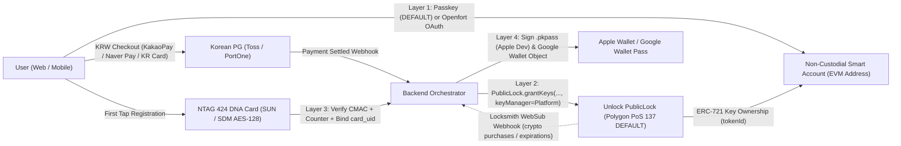

# Unlock Protocol × Korea Fiat × NTAG 424 DNA × Wallet Pass — Consolidated Architecture & Agent Delegation Spec

> **Mandatory Instruction for Implementing Agents:**  
> Do **not** guess APIs, contract addresses, payment eligibility, or hardware specs from memory. Before writing code or ordering components, fetch and read the primary documentation and vendor pages linked in **Section 6** and verify live Bithumb / PG / Unlock state. Where `[DEFAULT]` is marked, treat that choice as the architecture baseline unless explicitly overridden by the project owner.

---

## 1. End-to-End Four-Layer Binding Model (System Overview)

The system separates **identity/wallet**, **on-chain membership truth**, **revocable physical NFC tokens**, and **mobile wallet passes** so that no single device, browser cache, or physical card is a single point of failure.

### Canonical Database Binding Schema (Backend Source of Truth)

| Entity | Key Columns | Binding Role |
| :--- | :--- | :--- |
| `users` | `id`, `auth_provider`, `email_or_sub` | App user profile |
| `wallets` | `user_id`, `smart_account_address`, `credential_id`, `public_key_xy`, `wallet_provider` | **Layer 1:** Deterministic counterfactual EVM address + WebAuthn public key (or Openfort ref) |
| `memberships` | `chain_id`, `lock_address`, `token_id`, `owner_address`, `key_manager_address`, `pg_order_id`, `status` | **Layer 2:** Mirrors on-chain Unlock `PublicLock` state + links Korean PG order for refund/revocation |
| `nfc_cards` | `card_uid`, `token_id`, `lock_address`, `aes_key_id`, `last_counter`, `status` (`active` \| `deactivated`), `activated_at` | **Layer 3:** Binds physical NTAG 424 DNA chip to `token_id`; supports instant deactivation & replacement without re-minting NFT |
| `wallet_passes` | `token_id`, `apple_serial_number`, `apple_push_token`, `google_object_id`, `pass_status` | **Layer 4:** Tracks issued Apple `.pkpass` and Google Wallet objects for APNs/REST state updates |

---

## 2. Layer-by-Layer Architecture & Selected Defaults

### Layer 0: Chain, Gas & Bithumb KRW Treasury Setup

* **`[DEFAULT]` Network & Gas Token:** **Polygon PoS + `POL` (with optional native Circle `USDC` pricing/settlement)** (Chain ID `137`)
  * *Why:* Lowest Bithumb cash outlay (`0.009` POL min withdrawal & fee, bounded only by Bithumb's `5000` KRW order minimum), sub-cent on-chain gas, zero bridging hops, mature Unlock Protocol support, native Circle `USDC` availability, and strong enterprise payment/stablecoin adoption (Stripe USDC checkout, Revolut stablecoin transfers, Mastercard 24/7 stablecoin settlement).
  * *Architecture note:* Polygon PoS is a sidechain rather than a Stage 1 Ethereum rollup, but all Unlock `PublicLock`, `viem/account-abstraction`, and NTAG 424 DNA logic remains EVM-portable to Stage 1 rollups if needed later.
* **`[ALTERNATIVE - Stage 1 Ethereum Rollups]`:** **Arbitrum One + `ETH`** (Chain ID `42161`) or **OP Mainnet (Optimism) + `ETH`** (Chain ID `10`)
  * *Why:* L2BEAT Stage 1 rollups (BoLD / Cannon fault proofs) with direct `ETH` withdrawal from Bithumb (`0.01` ETH min withdrawal, ~26000 KRW upfront wallet funding, sub-cent withdrawal fee).
* **`[ALTERNATIVE — Consumer Ecosystem, +1 Bridge Hop]`:** **Base + `ETH`** (Stage 1 OP Stack, high Unlock consumer/wallet adoption; Bithumb does **not** directly support Base withdrawals, so withdraw `ETH` to Arbitrum One or Optimism and bridge once via Superbridge, Across, or Relay).
* **`[DO NOT USE]`:**
  * **Ethereum Mainnet:** High Bithumb withdrawal fee and high L1 `PublicLock` deployment/minting gas.
  * **BNB Smart Chain (`BNB`):** Steep `0.2` BNB minimum withdrawal on Bithumb.
  * **Direct `USDC` or `USDT` withdrawals from Bithumb for L2s:** Bithumb `USDC` only supports Ethereum & Arc (Arc is not supported by Unlock); Bithumb `USDT` only supports Ethereum, Tron, Kaia, and Aptos (latter three unsupported by Unlock).
  * **`ARB`, `OP`, or `SCR` tokens for gas:** Those are governance tokens; Arbitrum, Optimism, Base, and Scroll all pay gas in **`ETH`**.
  * **`GNO`:** Listed on Ethereum Mainnet only on Bithumb; Gnosis Chain uses `xDAI` for gas.

#### Bithumb Withdrawal Reference Table
Benchmark rates applied for USD/KRW normalization: `USD/KRW = 1336`, `ETH/USD = 1945`, `POL/USD = 0.0885`, `AVAX/USD = 8.25`. *(Bithumb KRW market minimum order size is `5000` KRW across all assets; dynamic withdrawal fees vary with network gas.)*

| network | gas_token | bithumb_direct | min_withdrawal_native | min_withdrawal_usd | min_withdrawal_krw | withdrawal_fee_native | withdrawal_fee_usd | withdrawal_fee_krw |
| :--- | :--- | :--- | ---: | ---: | ---: | ---: | ---: | ---: |
| Arbitrum One | ETH | Yes | 0.01 | 19.4500 | 25985.2 | 0.00000177 | 0.0034 | 4.6 |
| Optimism | ETH | Yes | 0.01 | 19.4500 | 25985.2 | 0.00000019 | 0.0004 | 0.5 |
| Polygon PoS | POL | Yes | 0.009 | 0.0008 | 1.1 | 0.009 | 0.0008 | 1.1 |
| Avalanche C-Chain | AVAX | Yes | 0.01 | 0.0825 | 110.2 | 0.01 | 0.0825 | 110.2 |
| Ethereum Mainnet | ETH | Yes | 0.005 | 9.7250 | 12992.6 | 0.005 | 9.7250 | 12992.6 |

#### Korean VASP / Bithumb Operational Tips
1. **Travel Rule Address Book:** Pre-register the deployer/minter self-custody wallet under `[입출금] -> [주소록]` with PASS verification + signature (required even under `1000000` KRW; supported personal wallets include MetaMask, Trust Wallet, Klip, imToken PC, OKX Wallet PC; connect Ledger via MetaMask).
2. **KRW Deposit Withdrawal Lock (`가상자산 출금 지연제도`):** First-ever KRW deposit triggers a **72-hour** external crypto withdrawal hold; subsequent KRW deposits trigger a **24-hour** hold on the equivalent amount.
3. **Live Fee Check:** Bithumb attempted and subsequently cancelled a 1% percentage fee policy in May 2026; majors like `ETH` retain standard fees, but agents/operators must confirm the live `[출금]` screen before sending.

---

### Layer 1: User Authentication & Non-Custodial Wallet Connection

* **`[DEFAULT]` Open-Source Passkey Smart Account (`viem` + `permissionless` + `ox` + `wagmi`) — `$0/month` SaaS**
  * **Packages:** `viem`, `permissionless`, `@permissionless/wagmi`, `wagmi`, `@tanstack/react-query`, `ox`.
  * **Implementation Pattern:**
    1. Call `createWebAuthnCredential` from `viem/account-abstraction`.
       * **Critical options:** Omit `authenticatorAttachment` (do not force `'platform'` or `'cross-platform'`) and set `residentKey: 'required'`, `userVerification: 'preferred'`. This ensures users without fingerprint scanners or USB hardware keys can use OS PIN/passcodes or synced password managers (iCloud Keychain, Google Password Manager, 1Password)—not `localStorage` burner keys.
    2. Convert to `passkeyOwner = toWebAuthnAccount({ credential })`.
    3. Instantiate a counterfactual smart account (`toSafeSmartAccount` or `toKernelSmartAccount` via `permissionless/accounts`) to obtain `smartAccount.address`.
    4. Persist `(credential.id, publicKey, smartAccount.address)` in `wallets`.
  * **Why it stays `$0/month`:** Because the backend minter calls `grantKeys` on Unlock and login sessions verify WebAuthn / EIP-1271 / EIP-6492 signatures off-chain, no bundler or Paymaster UserOp is needed at signup or mint time.
  * **Caveat:** WebAuthn still invokes a native OS/password-manager passkey prompt, and on-chain P-256 verifiers generally check the WebAuthn `UV` flag (satisfied by OS PIN/passcode/manager).

* **`[ALTERNATIVE — Zero OS/Passkey Prompts, Kakao/Naver/Email Login]` Openfort + OpenSigner**
  * **Why:** Replaces Privy ($499/mo Scale plan for up to 9,999 MAU; $299/mo Core; 499 MAU free limit) with `$0/month` base up to `2000` wallet operations/month (`~$0.01/op` after; sign-ins and reads are free; no MAU penalty). Supports Bring-Your-Own-Auth (Kakao, Naver, Google, email JWT) and open-source Shamir KMS (`OpenSigner`).
* **`[OTHER ALTERNATIVES]`:**
  * **Coinbase Smart Wallet:** `coinbaseWallet` (`wagmi/connectors`) or `toCoinbaseSmartAccount` (`viem/account-abstraction`) — `$0/month` for standard popup flow (CDP white-label embedded API gives 5,000 free ops/mo then $0.005/op).
  * **Porto by Ithaca:** Open-source (MIT/Apache-2.0) passkey + EIP-7702 smart accounts with `wagmi`/`viem`.
  * **Alchemy Account Kit:** `$0/month` base (30M Compute Units/mo free; PAYG `$0.525` per 1M CUs + ~`8%` Paymaster admin fee) if sponsoring user-submitted UserOps later.
  * **ZeroDev / Biconomy:** `@zerodev/passkey-validator` + `@zerodev/sdk` (requires `passkeyServerUrl`; ~100 MAU free, ~$99/mo Growth) or `@biconomy/sdk` + `@biconomy/passkey`.

---

### Layer 2: Korea-Native Fiat Checkout & Unlock Protocol Integration

* **`[DO NOT USE]` Unlock Native Stripe Checkout / Events by Unlock Stripe Connect (`/v2/stripe/connect/{network}/locks/{lockAddress}`):**
  * South Korea is **not** a natively supported Stripe merchant country. A Korea-domiciled entity or individual with a Korean bank account cannot open a local Stripe Connect account to receive payouts. (Stripe Connect only works if operating through a foreign entity/bank in a supported country such as a US LLC via Stripe Atlas.)
* **`[DEFAULT]` Korean PG Checkout + Backend `grantKeys` Minting:**
  1. **Contract Setup:** Resolve core Unlock factory & RPC via `@unlock-protocol/networks` (`networks[137].unlock` for Polygon PoS). Deploy a `PublicLock` contract with the platform's backend minter address added as a **Lock Manager** (optionally configuring native Circle `USDC` on Polygon for cross-border crypto checkout or treasury settlement accounting).
  2. **KRW Payment:** Present a Korean PG checkout (e.g., **Toss Payments** or **PortOne**) supporting Korean credit/debit cards, KakaoPay, and Naver Pay.
  3. **Server-Side Minting:** Upon server-verified PG webhook confirmation, the backend minter calls `grantKeys` (or `grantKeyExtension` for renewals) on the `PublicLock`, passing `recipient = smartAccount.address`.
  4. **Refund / Chargeback Protection Tip:** Always set `keyManagers` in `grantKeys` to a **platform-controlled address**—not the user's wallet—so your backend retains authority to expire/cancel keys (`cancelAndRefund` / `expireAndRefundFor`) if a KRW payment is refunded or disputed.
  5. **Optional Parallel Crypto Checkout:** Keep on-chain `purchase` enabled on the same `PublicLock` and subscribe to **Locksmith WebSub webhooks** (`https://locksmith.unlock-protocol.com/api/hooks/:network/locks/:lock/keys`; implement the W3C WebSub `GET` verification returning raw `hub.challenge` with HTTP 200) so crypto mints trigger the exact same Layer 3 & Layer 4 provisioning.

---

### Layer 3: Physical NFC Card Binding (`NTAG 424 DNA`, Activate / Deactivate)

* **`[DEFAULT]` Chip Standard:** **NXP NTAG 424 DNA** (AES-128 **SUN / SDM** dynamic URL authentication). Never use static NTAG213/215/216 for membership verification because static UIDs/URLs are trivially cloned.
* **Encoding Requirement:** NTAG 424 DNA tags require AES key configuration and SDM mirroring (e.g., via GoToTags Desktop App, NXP TagWriter, Seritag Ixkio, or a PC/SC desktop reader script)—basic mobile NDEF writers cannot provision SDM keys.
* **Anti-Single-Point-of-Failure Binding & Verification Rules:**
  1. **Activation (First Registration):** Authenticated user (`Layer 1`) holds an active Unlock key (`Layer 2`) and taps their unactivated NFC card. The card opens `https://yourapp.com/tap?picc=...&cmac=...` (or UID+counter+CMAC mirror). Backend decrypts/verifies the AES-128 CMAC and monotonic counter, checks the card is unclaimed, and binds `(card_uid, status='active', last_counter)` to `token_id`.
  2. **Runtime Check-In Verification (All 3 Checks Required):**
     * Verify AES-128 SUN CMAC signature and enforce `tap_counter > last_counter` (blocks replay attacks), updating `last_counter`.
     * Verify `nfc_cards.status === 'active'`.
     * Verify live Unlock membership validity on-chain (`PublicLock.getHasValidKey(owner_address)` === `true`).
  3. **Deactivation & Replacement:** If a card is lost or stolen, flip `nfc_cards.status = 'deactivated'` in the DB. The member keeps their on-chain Unlock NFT and mobile wallet pass uninterrupted, and a new physical NTAG 424 DNA card can be bound to the same `token_id`.

---

### Layer 4: Mobile Wallet Pass (`Apple Wallet .pkpass` & `Google Wallet`)

* **`[DEFAULT]` DIY Custom Pass Service (Apple Developer `Pass Type ID` + Google Wallet Issuer API):**
  * **Apple Wallet:** Use the owner's existing **Apple Developer** account to register a `Pass Type ID` and signing certificate. Backend generates signed `.pkpass` bundles (generic/eventTicket style) encoding a signed check-in QR payload mapped to `token_id`, and registers device push tokens for silent APNs pass updates when membership status or bound-card status changes.
  * **Google Wallet:** Issue matching pass classes/objects via the Google Wallet Issuer API and push state updates via REST.
* **`[ALTERNATIVE — Quick QR Prototype Only]` Events by Unlock + EthPass:** Available out of the box via Unlock Keychain / mint confirmation for QR passes, but limits branding, ties UX to Unlock's default flow, and does not solve Korean PG checkout.
* **NFC Wallet Caveat (QR in v1 vs. Phone-Tap NFC):**
  * Standard `.pkpass` signing enables **QR/barcode passes immediately with zero extra Apple approval**.
  * Phone-tap NFC inside **Apple Wallet (Apple VAS)** requires applying to Apple Developer Support for a restricted **NFC Pass / VAS Entitlement** on the `Pass Type ID` plus VAS/ECP-compatible reader hardware. **Google Smart Tap** similarly requires Smart Tap keys and certified NFC terminals (PAX, Ingenico, Verifone, IDTech). Ship QR passes + physical NTAG 424 DNA card taps first; layer Apple VAS / Google Smart Tap later only if deploying certified venue POS readers.

---

## 3. Physical Card Hardware Stack, Tips & Fabrication Rules

> **Critical Hardware Physics Rules:**
> 1. **Do NOT cut or solder coils onto raw NFC chips**—it destroys 13.56MHz impedance matching and breaks NTAG 424 DNA AES-128 communication.
> 2. **Pre-assembled NTAG 424 DNA + LED tags are not stocked in small retail runs** (note: Lab401 LED tags are NTAG 213, and AliExpress LED stickers are typically NTAG213/215 or chip-less).
> 3. **Side-by-side, non-overlapping placement:** Stick an intact **NTAG 424 DNA** inlay/sticker on one area of the card and a separate, smaller **chip-less passive 13.56MHz LED sticker** beside it with **no coil overlap**, both sitting over an **HF 13.56MHz ferrite sheet** (or buy pre-shielded on-metal NTAG 424 stickers with ~`0.2` mm ferrite built in). Overlapping steals RF power and can abort cryptographic reads.
> 4. **Thickness target (CR80 standard is `0.76`–`0.84` mm):** Combining a `0.3`–`0.4` mm metal backplate + `0.1`–`0.2` mm 13.56MHz ferrite sheet + wet inlay / LED sticker + `0.15`–`0.25` mm front PVC/PET overlay yields ~`0.85`–`1.1` mm total.
> 5. **One-sided scanning:** Ferrite blocks eddy currents from the metal plate—the card scans and lights up from the **plastic front face only**, not through the metal back.
> 6. **Laser engraving safety order:** Always laser-engrave or CNC-engrave the metal plate **before** laminating the ferrite sheet, NFC inlays, or PVC overlay. Never laser assembled PVC (releases toxic chlorine gas and melts/detunes the coils).
> 7. **Prototype first:** Test coil placement, phone antenna sweet spots, and LED brightness using cheap NTAG213 stickers + LED stickers over ferrite before bonding NTAG 424 DNA tags.

### Engraving Cost & Shop Reality (Seoul / Korea)
* **Makerspace caveat:** Public makerspaces like FabLab Seoul typically run $\text{CO}_2$ lasers (for acrylic/wood), **not** walk-in fiber lasers for deep metal engraving. Advanced university labs generally restrict metal fiber lasers to certified founders or staff-run fabrication requests.
* **Deep Engraving (`음각`) Cost Benchmarks:**
  * **Local Seoul workshops (e.g., Euljiro / Jongno / Hongdae with own metal plates + `.ai`/`.dxf` vector files):** Setup fee (`기본료/세팅비`) ~`10000`–`30000` KRW + several thousand KRW per card at small batch sizes (or ~`10000`–`20000`+ KRW for a single sample). Bring 1–2 extra blanks for depth calibration.
  * **Turnkey custom metal card vendors (plate + engraving):** ~`20000`–`50000` KRW per card for standard laser custom work; `50000`+ KRW per card for precision **CNC deep engraving (`CNC 음각`)**.

---

## 4. Agent Delegation & Orchestration Plan

Dispatch the following parallel workstreams, requiring each agent to **inspect the relevant Section 6 links first**:

| Agent Role | Scope & Deliverables | Pre-Read Links & Dependencies |
| :--- | :--- | :--- |
| **1. Protocol & Treasury Agent** | Deploy `PublicLock` on Polygon PoS (`137`) via `@unlock-protocol/networks` (optional native Circle `USDC` pricing/treasury leg); configure backend minter as Lock Manager; document Bithumb `POL` funding (`5000` KRW order min / `0.009` POL withdrawal min) + whitelisting checklist. | `@unlock-protocol/networks`, Unlock Docs; no dependency on UI |
| **2. Auth & Smart Account Agent** | Implement `viem/account-abstraction` Passkey onboarding (`createWebAuthnCredential`, `toWebAuthnAccount`) + `permissionless` Safe/Kernel account derivation (`$0/mo`); expose `/auth/register`, `/auth/login`, `/auth/verify-signature` (EIP-1271/6492). *(Fallback interface ready for Openfort if zero-prompt Kakao login is selected.)* | Viem AA Docs, Pimlico `permissionless.js` Docs, Openfort Docs |
| **3. Korean PG & Minting Agent** | Integrate Toss Payments / PortOne KRW checkout; on webhook confirmation call `PublicLock.grantKeys(..., keyManagers=[platformMinter])`; subscribe to Locksmith WebSub webhooks (`/api/hooks/:network/locks/:lock/keys`); implement refund -> key revocation handler. | Unlock Locksmith / Webhooks Docs, Korean PG SDK; depends on Agents 1 & 2 |
| **4. NTAG 424 DNA & Check-In Agent** | Implement AES-128 SUN CMAC + monotonic counter verifier; build `/nfc/activate`, `/nfc/deactivate`, `/nfc/replace`, and `/nfc/verify` endpoints enforcing all 3 checks (CMAC+counter, `status=='active'`, `getHasValidKey`); write provisioning script for NTAG 424 DNA SDM setup. | NXP NTAG 424 DNA / GoToTags / Seritag encoding docs; depends on Agents 1–3 |
| **5. Mobile Wallet Pass Agent** | Set up Apple Developer `Pass Type ID` certificate + `.pkpass` generator + APNs push updater; implement Google Wallet Issuer API pass creation & state sync; trigger updates on mint, expiration, revocation, and card re-binding. | Apple PassKit Docs, Google Wallet Issuer API; depends on Agents 2 & 3 |
| **6. Hardware & Engraving Procurement** | Order small-batch test kit (on-metal/wet NTAG 424 DNA inlays, chip-less 13.56MHz LED stickers, `0.1`–`0.2` mm HF ferrite sheets, metal blanks); verify AliExpress/vendor NTAG 424 chips with NXP TagInfo app; submit `.ai`/`.dxf` files for pre-assembly deep engraving. | Section 6 Verified Hardware & Engraving Links |

---

## 5. Verification Acceptance Criteria (Definition of Done)

1. **Zero-Hardware Passkey Flow:** A user on a desktop without a fingerprint reader completes registration via OS PIN/password manager and receives a deterministic `smart_account_address`.
2. **KRW Checkout → On-Chain Mint:** Completing a sandbox Korean PG payment triggers `grantKeys` on Polygon PoS (`137`) with `keyManager = platformMinter`, verifiable via `PublicLock.getHasValidKey(smart_account_address) === true`.
3. **Refund Revocation:** Triggering a PG refund revokes the Unlock key via `keyManager` and cascades status updates to `nfc_cards` and `wallet_passes`.
4. **NFC Anti-Clone & Deactivation:** Replaying a captured NTAG 424 DNA URL fails monotonic counter validation; deactivating a bound `card_uid` blocks check-in while keeping the user's Unlock NFT and Wallet Pass active; binding a replacement card succeeds against the same `token_id`.
5. **Hardware Read Test:** Assembled hybrid card (engraved metal back + `13.56MHz` ferrite + side-by-side NTAG 424 DNA & LED sticker + front overlay) reads reliably on iOS & Android smartphones and illuminates the LED without breaking the SUN NDEF read.

---

## 6. Verified Reference & Supplier Links (Checked HTTP-200)

*Agents must fetch and inspect the relevant links below before implementation or procurement:*

### SDKs & Protocol Infrastructure
* **Viem WebAuthn Account Abstraction:** https://viem.sh/docs/accounts/local/toWebAuthnAccount
* **Pimlico (`permissionless.js`):** https://docs.pimlico.io
* **Porto by Ithaca (Open-Source Passkey + EIP-7702):** https://github.com/ithacaxyz/porto
* **Openfort & OpenSigner (Zero-Prompt OAuth Privy Alternative):** https://www.openfort.io · https://github.com/openfort-xyz
* **ZeroDev Docs:** https://docs.zerodev.app
* **Biconomy SDK:** https://github.com/bcnmy/sdk

### Authentic NTAG 424 DNA Tags & Inlays (Small Quantity)
* **ShopNFC — On-Metal Round NTAG 424 DNA ø22mm (built-in ferrite):** https://shopnfc.com/en/on-metal-nfc-tags/868-1723-on-metal-round-nfc-tags-ntag424-dna-o22mm.html
* **ShopNFC — NTAG 424 DNA Sticker ø22mm (non-metal):** https://shopnfc.com/en/nfc-stickers/487-nfc-stickers-ntag424-dna-d22mm.html
* **ShopNFC — CR80 PVC Card NTAG 424 DNA:** https://shopnfc.com/en/nfc-cards/596-1098-nfc-cards-in-pvc-ntag424-dna.html
* **GoToTags — FPC NTAG 424 DNA 24mm Circle Inlay:** https://store.gototags.com/fpc-nfc-tag-ntag-424-dna-24-mm-circle/
* **GoToTags — Glossy White PVC Card NTAG 424 DNA:** https://store.gototags.com/nfc-pvc-card-ntag-424-dna/
* **GoToTags — Full NTAG 424 DNA Catalog:** https://store.gototags.com/nfc-tags/nfc-tags-by-use/nxp-ntag-424-dna-nfc-tags/
* **AliExpress — NTAG 424 DNA Anti-Metal Search *(verify chips with NXP TagInfo)*:** https://www.aliexpress.com/w/wholesale-ntag424-dna-anti-metal.html

### Passive 13.56MHz LED Stickers & Ferrite Shielding
* **Adafruit — Chip-less RFID/NFC Nail Stickers (5-Pack White LEDs):** https://www.adafruit.com/product/3781
* **AliExpress — NFC LED Nail Stickers Search:** https://www.aliexpress.com/w/wholesale-nfc-led-nail-sticker.html
* **AliExpress — 13.56MHz HF Ferrite Sheet Search *(choose `0.1`–`0.2` mm HF)*:** https://www.aliexpress.com/w/wholesale-13.56mhz-ferrite-sheet.html

### Korea Engraving Workshops, Custom Metal Cards & Desktop Engravers
* **Goldenrod / 우주명찰 (Deep CNC & Custom Metal Card Engraving):** https://www.goldenrod.co.kr/
* **MinorLaser / 마이너레이저:** https://minorlaser.com
* **Haekwang Laser / 홍대 해광레이저공방 *(HTTP)*:** http://www.hlaser.co.kr
* **GoodsMade / 굿즈메이드:** https://goodsmade.co.kr
* **Kmong — 금속 레이저 각인 Search:** https://kmong.com/search?keyword=%EA%B8%88%EC%86%8D%20%EB%A0%88%EC%9D%B4%EC%A0%80%20%EA%B0%81%EC%9D%B8
* **HanmiPrint (Short-run metal cards):** https://www.hanmiprint.com
* **FabLab Seoul (CO2 / non-metal reference):** https://www.fablabs.io/labs/fablabseoul
* **Desktop IR/Fiber Engravers (Korea):** [xTool Korea (`xTool F1`)](https://www.xtool.co.kr) · [LaserPecker (`LP3`/`LP4`)](https://www.laserpecker.net/)
