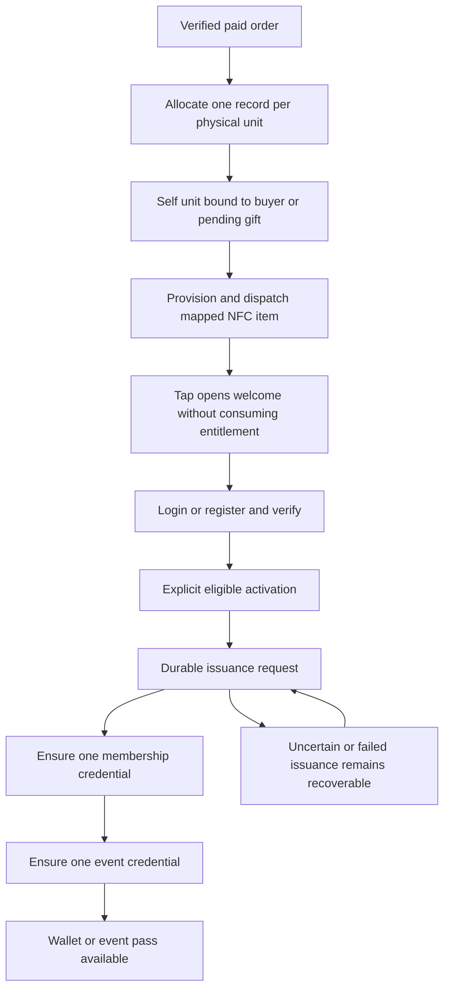

# Account, membership, event and NFC activation plan

**Updated:** 2026-11-11. **Phase:** planning / owner review; no implementation approval.

This revises the 2026-11-10 planning packet in place using the owner's subsequent
D1–D5 clarifications and physical-NFC activation proposal. The owner has not
approved every detail of the earlier packet. Settled business rules below are
owner decisions; architecture choices and acceptance work are labeled separately.

The [commerce launch plan](commerce-launch-plan.md) remains the governing delivery
plan. This supplement revises its admission/account policy, not its financial,
shipping, public-auth, provider, recovery or deployment gates. Existing code may
be replaced where necessary to deliver the agreed behavior; preserving its current
shape is not a business constraint. No reset, destructive rewrite or remote action
is authorized by that flexibility.

Source task list: [owner To-Do List](<../To-Do List.md>),
lines 28–35. Tickets/accounts, Unlock exploration, wallet/NFC goals and purchase UI
remain represented; none is deleted or marked implemented. Original routing IDs
1a, 1b, 2 and 3 map to the execution slices below. NFC extends those workstreams.

## Progress and review panel

| State | Scope | Evidence / next gate |
| --- | --- | --- |
| Complete — planning | D1–D3 policy reconciliation | Event-bound buyer-first allocation, one bound package, pending gifts and existing/new recipient accounts recorded below. |
| Complete — planning | D4/D5 and NFC direction | Bearer gift claim separated from admission; Unlock is the preferred integration to pursue, not a launch dependency. Physical activation is the primary proposed experience; earlier-mint welcome/reveal remains an alternative. |
| Complete — planning | Source grounding and implementation sequence | Current source owners, dependency map, state transitions and acceptance cases below. No implementation or runtime acceptance. |
| Open — design/proof | Wallet/control, Unlock issuance/check-in integration | Select the narrowest compatible path; prove native capabilities before adding parallel systems. No credentials, SDK install, contract deployment or RPC calls approved. |
| Open — owner policy | Replacement, token transfers, post-activation returns, delivery delay | Batched decisions below; do not reopen settled launch rules. |
| Not started | Product code, migrations, cinematic UI, tag provisioning and pilot | Require bounded implementation/experiment approval and resource-safe execution. |

**Current work:** review this consolidated plan and choose the next bounded batch.
**Next proposed batch:** P1, the offline Unlock/identity integration blueprint.
**Remaining:** P2–P7, external proofs where specifically approved, and the original
commerce plan's remaining delivery milestones. The canvas is left stopped; it is
not reopened or used as a feedback listener by this planning update.

**Fragile final pass, highest risk first:**
1. Reserve buyer-first ownership at payment, not at NFC tap; duplicate orders or
   delayed activation must not create another self ticket.
2. Keep identity, paid allocation, tokens and check-in distinct; one membership
   issuance must not create an extra current-event allocation.
3. Keep one coordinated event capacity and one authoritative check-in outcome;
   token grant limits are not assumed to enforce our stock or guest limits.
4. Keep NFC bearer secrets out of PII, telemetry and public metadata. Never greet
   a gift recipient as the buyer or treat a copied tag as physical authenticity.
5. Reconcile uncertain chain outcomes and payment/refund holds; no automatic
   recharging, duplicate minting or silent switch of activation mode.
6. Accept the actual physical object, real phones, full-motion UI and recovery
   operations separately from source tests and synthetic provider responses.

## 1. Settled product and policy model

### D1/D2 — launch, purchasing and allocation

- There are **zero minted memberships at launch**. There is one purchase flow,
  not separate launch journeys for existing members and nonmembers.
- An account can exist without membership. Canonical account verification is not
  itself an Unlock membership token, and a token is not a login session.
- Membership permits the relevant purchase flow; it does not automatically grant
  a free or reserved event seat. This initial sale bootstraps membership and the
  purchased event entitlement together, without requiring a token before the
  first purchase can occur.
- The sale is for a real shipped physical product with an event-admission benefit.
  The owner reports that this structure addresses their provider/commercial
  constraints. This is not an independent legal finding or PG approval. Product
  photos/specification, shipping and disclosures must remain accurate.
- At authoritative paid settlement, if the buyer has no bound entitlement for
  this event, designate and bind the first unit to that account. All other units
  become pending gifts. If the account is already bound, all units are gifts and
  none may be attached as an additional self ticket.
- The first order may include self plus gifts in one payment. One account can
  hold **one ticket/package for this event**, whether acquired by purchase or gift.
  Self-binding consumes that package. This event-bound ownership limit is distinct
  from the existing net-three purchased-coin allowance per account/release.
- Delayed membership/event minting does not reopen ownership allocation. A buyer
  returning before physical activation is already self-bound in our allocation
  ledger; a second order must not allocate another self unit.
- Repeat callbacks must recover the original per-unit allocation, not rerun a
  branching rule that now sees the buyer as already bound and converts self to gift.

### D3/D4 — gift claim and the eventual admission credential

- A gift is a pending entitlement, not a fake canonical user with invented contacts.
- An activation link admits an existing or newly registered account into login,
  verification and explicit claim. Eligible bearer possession is sufficient;
  recipient preselection and buyer confirmation are not part of the chosen rule.
- A recipient already bound for this event cannot claim another gift. Completing
  verification must not merge accounts, reassign a self unit or grant a second package.
- The activation code authorizes **gift claim only**. After successful claim, the
  bound event entitlement/token/pass supplies admission credentials. Do not reuse
  the raw activation secret as a door credential or account authentication key.
- The owner wants a clear bearer-secret handling/loss warning. Whether the buyer
  can revoke and replace an unclaimed code remains open; inability to recover the
  original secret does not by itself decide replacement policy.
- The current account-bound activation direction supersedes the old name-only,
  no-account guest-admission path. The four Part I drinks and shared Part I→II
  transport package remains one per eligible activated account/event; exact
  redemption/check-in behavior must still pass acceptance.

### D5 — membership tokens and event tokens

- Sophomores owns accounts, verification, the account/wallet association, commerce,
  fulfillment, allocation and activation orchestration. Unlock is the preferred
  token/membership/event tooling to pursue rather than a technology to dismiss.
- The intended model has a membership credential plus an event-specific credential.
  Receiving membership during this sale must satisfy, not duplicate, the allocation
  already used to issue its event ticket. No automatic free-seat airdrop is inferred.
- Wallet passes and physical NFT/NFC experiences are explicit goals, although the
  owner does not make them dependencies for the site's launch. If the preferred
  integration is not accepted, any fallback or deferral is an owner decision—not
  permission to drop the work silently.
- A finite public giveaway path remains a separately configured possibility.
  Free-pool claims, purchased gifts and self units retain their provenance and
  consume coordinated event capacity. Do not turn every minted membership into
  an unrestricted giveaway or make an unapproved giveaway publicly available.
- Future events may use existing membership more directly. Future pricing,
  seat allocation and whether another event NFT is necessary are not decided here;
  each event still needs its own capacity and attendance-consumption record.

## 2. Primary proposal: physical receipt unlocks activation

**Customer experience:** receive the physical item → tap → a polished welcome →
login/register and verify where needed → explicit activation → membership and event
credential become available. Token mechanics are disclosed proportionately, not
turned into another customer product choice or blockchain onboarding ceremony.

**Critical distinction:** payment establishes the bought entitlement and its self/
gift allocation immediately. Receipt/tap initiates activation and deferred token
issuance; it does not establish whether the customer paid or owns a self unit.

This is a proposed implementation flow, not a claim that native Unlock Events
already performs every transition. Ordinary static NFC links also cannot prove
that the physical item has arrived: anyone who obtains the link can open it. If
strict receipt attestation is required, additional evidence/hardware is a separate
scope. This pilot treats secret access plus the activation checks as sufficient.

### Alternative retained: earlier issuance plus welcome/reveal

The same physical tag can launch the same welcome while token issuance happens
earlier. For the known self recipient, this may be straightforward once a wallet
is associated. Unknown gift recipients still need a real pending claim and initial
token custody/transfer design; calling the tap a reveal does not remove that work.

The server-side unit record selects the approved mode; the NFC URL should not
encode a permanent mint-timing decision. Do not live-switch paid units between
modes without reconciling their existing claim and token state. A later hybrid
can issue known self credentials early and gift credentials at activation, if
explicitly chosen. It is not the default silently substituted for the primary flow.

## 3. Data, authority and lifecycle boundaries

| Concept | Source of truth / responsibility | Required invariant |
| --- | --- | --- |
| Account and verified contact | Existing canonical Better Auth/Payload identity plus approved phone proof | No placeholder account, token-based login bypass or second issuer. Never publish contact/shipping PII onchain. |
| Product, cart, payment, inventory, order, shipping | Payload ecommerce and verified PortOne path | Real paid proof and immutable charge history; token failure cannot trigger another charge or erase a paid order. |
| Per-unit entitlement | Server-controlled order-unit allocation | Stable self/gift designation, one bound account/event; giveaway provenance when applicable. |
| Physical tag mapping | Server registry and fulfillment manifest linked to that unit | One active intended activation bearer per unit; verify the programmed tag against the packed unit. |
| Membership token | Selected Unlock membership contract and reconciled account/wallet mapping | Ensure existing membership before requesting another; distinguish valid, pending, missing and unknown. |
| Event token/pass | Selected event contract/tooling linked to the same canonical event entitlement | No second allocation when membership is issued; exactly one intended event credential per allocation. |
| Check-in and package redemption | One selected operational authority, coordinated with event entitlement/holds | No independent conflicting local and Unlock check-in flags; duplicate scans cannot admit twice or add packages. |

Proposed logical records are requirements, not final schema names. Prefer extending
existing admissions, claims, reservations and fulfillment records over creating a
parallel engine. Choose placement by real ownership; do not dump new logic into
shared utils/lib or create custom wrappers around installed library equivalents.

Maintain separate dimensions rather than one giant status field:
- **Financial:** confirmed paid, uncertain, refunded or review-held.
- **Allocation:** self-bound, unclaimed gift, claimed gift or revoked/held.
- **Physical:** unprovisioned, provisioned/packed, dispatched, delivered or replacement.
- **Issuance:** not requested, durably queued, submitted/unknown, confirmed or failed.

Activation checks the applicable dimensions under a transaction. Persist the
assignment and issuance request together; submit onchain work after the DB commit.
A durable job/outbox is a proposed mechanism, subject to the installed-library
and internal-module gate. A browser redirect or unverified webhook is never the
sole authority for payment, identity or successful token issuance.

If membership succeeds but event issuance fails, retain that result and recover
only the missing event credential. If a transaction submission times out, reconcile
the same operation before resubmitting. Refunds racing an irreversible mint need a
hold/revocation decision, not an assumption that the chain participates in our DB
rollback. Contract/version idempotency must be proved rather than inferred.

## 4. NFC, privacy and physical operations

- One ordinary NDEF HTTPS activation link per unit is the baseline. A native app,
  browser Web NFC API or crypto-capable NFC chip is not required just to open it.
- Use an unguessable bearer, not a buyer ID/order number, name, phone or address.
  Keep the stable unit association server-side. Store bearer digests and never
  log raw secrets or include them in public NFT metadata or third-party QR tools.
- Reuse the existing fragment-only claim pattern where appropriate; remove the
  secret before account interaction. Authentication continuation must preserve
  the claim safely. The current claim page deliberately loses its in-memory secret
  on reload and restricts external account redirects: do not promise seamless
  Google/reload recovery without designing and testing that continuation.
- GET, tag scan, page preload and messaging previews must not consume, assign or
  mint. Require verified identity, eligibility and an explicit activation action.
- Self activation requires the bound buyer account; a gift bearer can activate only
  for an eligible verified account. Once activated, copied links cannot transfer
  ownership. Subsequent taps by the owner reopen their pass; other accounts do not
  receive private member, buyer or order information.
- The pre-auth welcome is generic unless the actual holder is safely known. The
  buyer, shipping recipient and attendee may be different people. A self greeting
  may be personalized after recognition; a gift must not greet its recipient as
  the buyer or expose the purchaser's address/contact details.
- Existing secret handling supports a short pilot without inventing an elaborate
  authenticity system. Static NFC is copyable; read-only programming prevents
  some rewriting, not copying. Keep pre-dispatch bearers protected and packaging
  appropriately controlled. Secure-chip anti-cloning is not selected by this plan.
- Prove the actual card/coin construction. Metal affects antennas; do not assume an
  ordinary sticker works inside/on a metal collectible. Test tag orientation,
  phone cases and practical read distance with the intended production sample.
- A QR/manual URL fallback may carry the same activation capability; it is not
  stronger identity proof. Protect it correspondingly. Define replacement and
  old-link invalidation before operating it.
- The owner's stated pilot is at most about 50 people over less than two weeks.
  This bounds rehearsal planning; it is not an invented event capacity, stock,
  sale schedule or reason to abandon atomic claims and secret protection.

## 5. Source grounding and known integration seams

Source inspection baseline remains Git `cb824922332606cd63f3f3b04b8a7c883f44d444` in
this worktree. The 2026-11-11 planning check found no tracked source changes here;
other checkout/Batch 7c work has not been copied, altered or claimed as accepted.
Package findings below are manifest/lockfile evidence, not an installed API test.

| Current owner | What exists / planned seam |
| --- | --- |
| `src/app/(site)/shop/page.tsx`; `src/app/(site)/tickets/page.tsx` | Canonical public commerce entry; tickets delegates to shop. Do not revive the old ticket catalogue authority. |
| `src/lib/commerce/access.ts`; `src/components/commerce/checkout.tsx` | Canonical verification/checkout gate exists. Separate verified-account readiness from minted-token membership so launch checkout cannot require a token that does not exist. |
| `src/lib/commerce/portone/adapter.ts`; `src/lib/commerce/ecommerce.ts` | Paid verification/finalization and succeeded-transaction admission grants exist. Add stable self/gift allocation to this actual transaction boundary. |
| `src/lib/commerce/reservations.ts`; `src/lib/commerce/_shared/transaction.ts` | Reservation, allowance and ordered transaction locking exist. Account/event binding must fit lock order and real PostgreSQL concurrency. |
| `src/lib/commerce/contracts.ts`; `src/lib/payload/collections/commerce-admissions/index.ts` | Versioned snapshot and per-order-unit admission fields exist. Extend deliberately; do not reinterpret old paid snapshots or reset history. |
| `src/lib/commerce/guests.ts`; `src/lib/commerce/domain.ts` | Claim verification, per-event account uniqueness, bounded operations, logging, check-in and benefit controls exist. Revise business semantics instead of preserving obsolete optional-name-only policy. |
| `src/lib/payload/collections/commerce-claims/index.ts` | Hashed, expiring/revocable/consumable claim records exist. Resolve persistent physical-tag activation versus current short-lived claim behavior. |
| `src/components/commerce/order-admissions.tsx`; `src/components/commerce/invitation-claim.tsx` | Buyer gift controls and explicit recipient claim exist. Extend for physical activation and safe auth continuation, not a second account store. |
| `src/lib/commerce/fulfillment.ts`; `src/lib/commerce/returns.ts` | Physical fulfillment and return/benefit holds exist. Add tag packing and replacement/activation reconciliation only where the approved policy requires it. |
| `tests/commerce/domain/guests.test.ts`; `tests/commerce/domain/reservations.test.ts`; `tests/commerce/domain/real-payload-acceptance.test.ts` | Existing node:test and explicit local-DB acceptance owners; synthetic serialization is not proof of real DB races. |
| `tests/commerce/ui/guests-dom.test.tsx`; `tests/commerce/ui/checkout.test.tsx` | Existing DOM/provider fixtures to extend; all new tests/fixtures remain under root `tests/`. |

Manifest/lock versions include Payload/ecommerce 3.92.1, Better Auth 1.7.12,
qrcode.react 4.2.0, next-intl 4.14.9, Motion 14.6.0 and Vaul 1.1.2. No Unlock
integration dependency is declared. `node_modules` and bundled Next guides are
absent here. Before implementation, obtain scoped dependency approval as needed,
inspect actual installed APIs/current docs, and reuse qrcode.react/native existing
primitives rather than add parallel helpers, animation or QR implementations.

## 6. Bounded implementation slices — not execution authorization

| Slice | Work and primary files | Dependency / acceptance |
| --- | --- | --- |
| **P1 — offline integration blueprint** | Specify account/wallet custody, membership/event contract identities, current-event relationship, issuer privileges and one check-in authority. Map existing Unlock Events/scanner/pass features and the minimum custom orchestration. No product code or credentials. | Distinguish documented, version-dependent and unproved behavior; name the smallest separately approved provider/device proof. Original step 2. |
| **P2 — account and paid allocation** | Test first, then revise existing commerce access, snapshots/reservations, settlement and admission fields. Ensure one stable self assignment per account/event; extra units are pending gifts. | P1's conceptual model; wallet provisioning itself is not needed for provider-free allocation tests. Prove concurrent first orders, replay, gift claims and returns. Original step 1a. |
| **P3 — tag registry and fulfillment** | Test per-unit bearer issuance, digest storage, packing/mapping checks, lifecycle and restricted operator access. Extend owning collections/fulfillment modules; additive migrations only after schema review. | P2 plus code expiry/replacement decisions. Simulate tag programming; actual encoding/purchasing needs hardware scope approval. Original step 1b plus NFC. |
| **P4 — verified physical activation** | Extend existing claim endpoint/UI for self-versus-gift handling, login/register, phone/email proof, explicit activation and safe continuation. Commit an issuance request with assignment. | P2/P3 plus wallet association contract from P1. Local fake issuer first; no real mint. Prove one package, correct identity and no leaked bearer. Original step 1b. |
| **P5 — recoverable Unlock issuer and event tooling** | Integrate the selected native grant/claim/pass/check-in path, stable mapping and durable retries. Inject transport for tests; reconcile membership-success/event-failure and unknown submissions. | P1/P4 and specifically approved dependencies/provider proof. Choose one check-in authority; do not recreate a native scanner without demonstrated mismatch. Original step 2. |
| **P6 — purchase clarity and cinematic activation** | Reflect forced self/gift allocation in canonical checkout. Add the polished 3D/full-motion welcome and actual issuance/pending/pass states to the activation owner. Approved interface copy stays in English catalogue. | P2/P4 contracts; fake/provider-free states may be developed before external acceptance. Live browser and harsh Santa review mandatory before UI completion. Original step 3 plus NFC. |
| **P7 — bounded pilot and operations acceptance** | Rehearse authentic phones/tags/packing, complete purchase→delivery→activation→pass→check-in→benefit journeys and adverse states with approved fixtures. Then perform only the separately approved live/testnet/provider scope. | P3–P6 plus product, custody, hardware, support/replacement and provider approvals. Keep deployment as the governing plan's final milestone. |

P3 and P6 do not justify concurrent bundlers or test runs in one checkout.
Implement actual production ownership boundaries, not the table's conceptual
labels as mandatory new directories. New modules/hooks/helpers must pass the
library-first and nearest-owner rules; framework-required files stay with owners.

### Test-first and acceptance matrix

| Case | Required result | Evidence layer |
| --- | --- | --- |
| First order, quantity three | One self-bound entitlement, two pending gifts; no premature token success. | Domain unit + real local DB integration. |
| Second order before physical activation | No second self entitlement; earlier unit remains bound even with no token minted. | Domain concurrency + checkout DOM. |
| Duplicate settlement / page refresh | Recover original allocation and original issuance identity, never reshuffle units or charge again. | Payment/domain integration + browser recovery. |
| Gift claimed by an existing/new account | Both converge on the same verified flow; an already-bound account is rejected without consuming another person's gift. | Claim/identity integration + browser. |
| Concurrent claims / two first orders | One account/event binding and one successful gift claim under real transaction locks. | Real local PostgreSQL, not only mocks. |
| New membership after claim | Does not produce another ticket, giveaway allocation or package. | Issuer/eligibility integration. |
| Scan, GET, preview bot, repeated tap | No claim/mint from opening; owner reopens existing pass after activation; another account gets no private data. | HTTP/DOM + real phone. |
| Partial/uncertain mint | Persist confirmed membership, reconcile submitted transactions, issue only missing credential; no duplicate charge or seat. | Injected transport tests + separately approved real proof. |
| Refund/hold racing activation or issuance | Block inappropriate grants; retain financial evidence and explicit unresolved/revocation state. | Domain/issuer integration + operator acceptance. |
| Gift code copied/replaced/expired | One claim only; old bearer invalidation follows the chosen policy; no onchain PII or raw bearer logs. | HTTP/security tests + operating rehearsal. |
| Personalization | Buyer/self and gift-recipient names are not confused; no shipping/contact data exposed before authorized identity. | DOM/browser + privacy review. |
| Tag/phone mismatch or late/lost delivery | QR/manual and approved support path preserves the paid entitlement; no invented automatic forfeiture policy. | Physical device/packing/support rehearsal. |
| Check-in/redemption duplicate scans | One admission consumption and the single account's authorized package; local and Unlock views do not diverge. | Integration + selected scanner/device proof. |

Target at least 80% coverage for new behavior with unit, integration and critical
browser journeys. Record RED/GREEN results, skips and limitations honestly; do not
weaken checks or treat static tests as provider/phone acceptance. Use one guarded
workload per checkout and maintain required physical-memory headroom. Do not start
Docker, a DB, an app preview or external proof under the current planning approval.

### UI acceptance

- One coherent purchase/activation, not a member/nonmember chooser. The mandatory
  self unit and gift remainder explain the rule without pretending it is a free
  allocation choice. Keep one physical order/address and truthful totals.
- A deliberate, polished 3D welcome with full motion; no new reduced-motion branch.
  Animation may accompany real work but must not fabricate successful issuance or
  strand customers behind an endless cinematic loading state.
- Generic pre-auth scene, personalized reveal only for the actual known holder;
  pending/failed/confirmed states remain legible and recoverable.
- Use existing graphics/Motion primitives where they meet the output/runtime need;
  inspect their real consumers and installed APIs before creating helpers. All
  changed UI styling is Tailwind-only; preserve BrandMark identity.
- Before drafting public copy, read identity and the working voice guide. Put
  approved first-party English UI strings in `messages/en.json`, render through
  next-intl, and make the matching structural `messages/ko.json` change (`""` for new keys) per AGENTS.md. Exact-one English labels under
  Korean formatting use tested ICU `=1` where applicable.
- Inspect touch, narrow fine-pointer and desktop live renders; test actual tap/
  notification/browser handoff, focus, long errors, cold/warm loading and repeat
  visits. Run one harsh concise Santa Method review before claiming UI completion.

## 7. Remaining decisions and proof gates

Settled D1–D3 and the bearer gift-claim policy must not be repeatedly reopened.
These are the remaining consequential choices, not reasons to block all local work:

| Gate | Required decision or proof | Blocks |
| --- | --- | --- |
| **G1 — wallet and issuer control** | Ordinary account UX with managed/embedded wallet versus user-controlled wallet; prove account association, recovery/key custody, allowed issuer/key-manager roles and one membership/token mapping. Do not assume Unlock hosted accounts replace canonical login. | P5 real integration; P4 continuation detail. |
| **G2 — gift secret and physical replacement** | Permanent loss versus buyer revoke/reissue while unclaimed; expiry relative to delivery/event; lost shipment/damaged tag process; who may view/program activation secrets. Preserve source evidence and invalidate replaced capabilities. | P3 operating lifecycle and pilot dispatch. |
| **G3 — token relationship, transfer and financial reversal** | Define logical versus enforced binding between account, membership and event token; transfer/recovery/replacement effects, partial return of self versus gift, after-activation refund and consumed-benefit cases. Prevent reminting/reclaim through transfers. | P2 reversal edge semantics, P5 contract policy and pilot. |
| **G4 — selected Unlock path and availability** | Prove the chosen version's membership/event grants, stable issuance reconciliation, current wallet exports and authorized single-use check-in. Confirm current operator/support/fee facts. No assertion that Events is automatically a parent-token-bound airdrop system. | P5 native adapter and any real proof. |
| **G5 — actual hardware and event timing** | Approve physical form factor/sample, encoding/packing procedure, real-device result and delayed-delivery access path. Do not invent product stock, chip cost, shipping date or event date. | Actual encoding, procurement, dispatch and P7. |

**Next proposed approval scope: P1 only.** Produce the concrete integration
blueprint from public docs, existing source and safe offline inspection. Compare
native Unlock options before custom code; return a minimal wallet/issuer/check-in
choice and a precisely scoped external proof request. No SDK installation,
credentials, wallet creation, chain/RPC/provider calls, hardware purchase/programming,
application implementation or deployment is included. After review, P2 is the next
provider-free implementation slice available for explicit approval.

## 8. Evidence, limitations and handoff

Public documentation reviewed during the 2026-11-10/11 discussion supports:
- [Unlock purchase versus grants](https://docs.unlock-protocol.com/core-protocol/public-lock/minting-keys): grants support issuance to recipients but do not automatically enforce sale-supply caps.
- [Unlock hooks](https://docs.unlock-protocol.com/core-protocol/public-lock/hooks): custom validation is possible; native parent-NFT binding/automatic distribution is not established by that fact.
- [Event check-in API](https://docs.unlock-protocol.com/api/locksmith/check-event-ticket) and [offchain metadata](https://docs.unlock-protocol.com/tools/locksmith/metadata): distinguish ticket consumption from merely owning/burning an NFT.
- [Apple Wallet export](https://docs.unlock-protocol.com/api/locksmith/generate-apple-wallet-pass), [Google Wallet export](https://docs.unlock-protocol.com/api/locksmith/generate-google-wallet-pass) and the [wallet-pass announcement](https://unlock-protocol.com/blog/unlock-labs-upgrades-apple-wallet-and-google-wallet-passes): documented QR-wallet support, not proof of secure native NFC admission.
- [Apple background NFC reading](https://developer.apple.com/documentation/corenfc/adding-support-for-background-tag-reading) and [Android NFC dispatch](https://developer.android.com/develop/connectivity/nfc/nfc): ordinary HTTPS tags can launch browser experiences on supported devices; OS notification/settings/hardware behavior needs real-phone acceptance.
- [NXP NTAG antenna guidance](https://community.nxp.com/pwmxy87654/attachments/pwmxy87654/nfc/6155/1/AN11276.pdf): metal/ferrite antenna construction matters for the actual collectible.

Unlock's [January 2026 funding transition](https://unlock-protocol.com/blog/unlock-dao-newsletter---january-2026)
and [February NFC/testing update](https://unlock-protocol.com/blog/unlock-dao-newsletter---february-2026)
are dated context, not a present service-status determination. Protocol operation,
hosted tools, scanner support and paid convenience services are distinct. The
owner's prior sub-$10 experience is relevant; no current budget is inferred.
Check the chosen grant/network path and current costs instead of treating hypothetical
infrastructure as a reason to reject the experience. Public reads are not provider
acceptance, and no mint/device integration has been tested by this plan.

Only planning documentation is changed in this batch. No source implementation,
English/Korean catalogue, source To-Do status, dependency, migration, credential,
provider, browser/canvas, container or deployment action occurs. The existing
review packet is replaced by this consolidated revision rather than kept as a
second competing plan. Earlier uncertainty is resolved only where the owner has
actually decided it; unresolved gates above stay explicit.

The historical commerce worklist/test receipts are not rerun or updated into a
claim of fresh acceptance. Before execution, inspect the target checkout's actual
source/dirtiness and installed Next guides; preserve separate-checkout Batch 7c
and unrelated owner work. This plan grants no blanket rewrite, commit, push,
production readiness assessment or launch approval.

Planning checks: the seven implementation slices, five remaining gates, all 22
explicit source/test file references and local Markdown links were checked. The
obsolete name-only policy was removed from the governing contract's active
admission section, and whitespace/diff checks passed. A tool-free planner review
challenged allocation-before-mint, gift identity, issuance retries and pilot
acceptance. These checks validate the planning packet, not application behavior.
